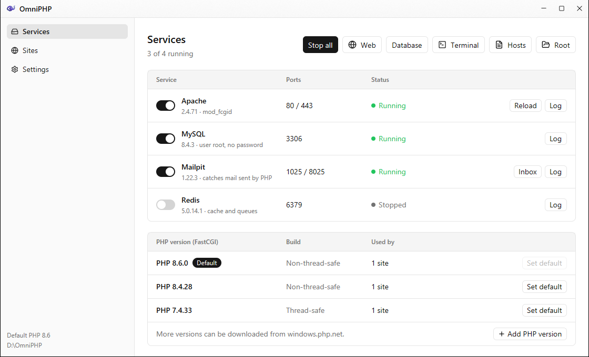
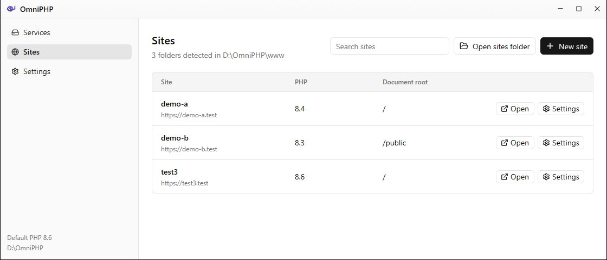
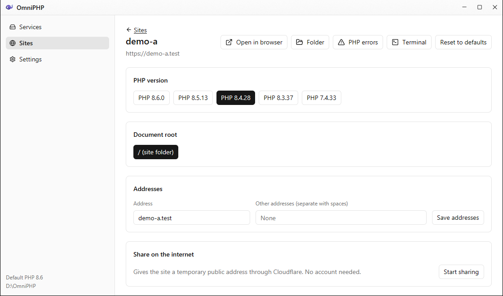
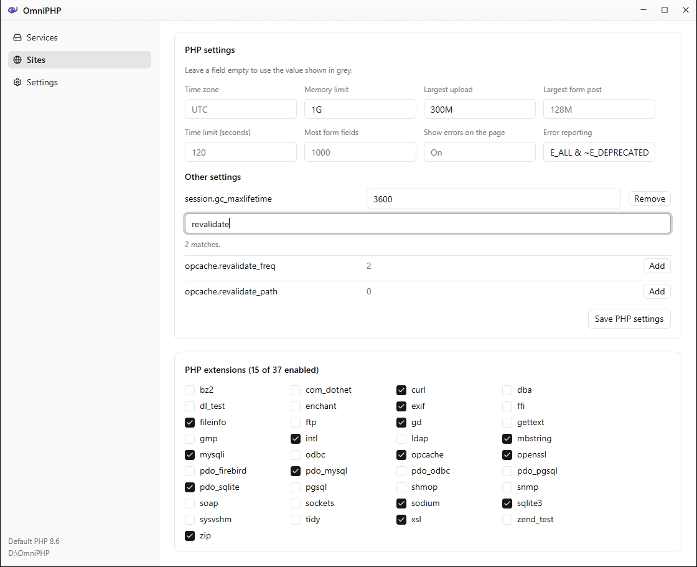
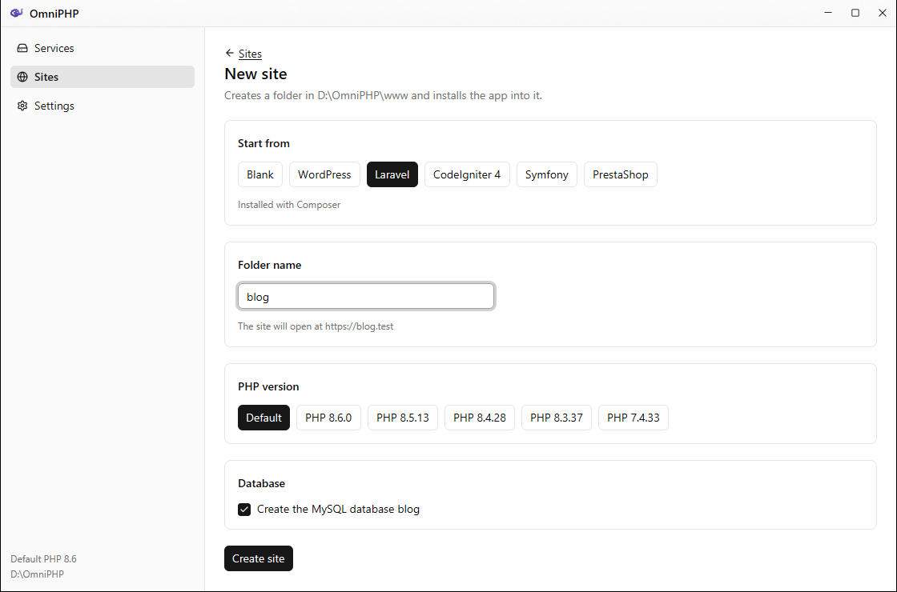
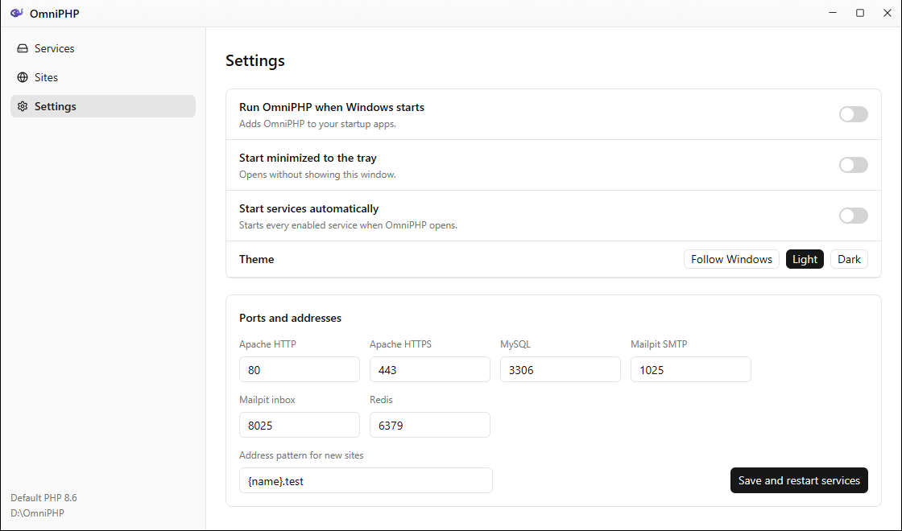

<p align="center">
  
</p>

<h1 align="center">OmniPHP</h1>

<p align="center">
  A friendly local PHP development environment for Windows,<br>
  where <strong>every site picks its own PHP version, extensions and php.ini settings</strong>.
</p>

<p align="center">
  
</p>

Drop a folder into `www\` and it is a site: `www\shop` opens at `https://shop.test`, with a
trusted HTTPS certificate, on the PHP version you chose for it. A legacy project on PHP 7.4 and
a new one on PHP 8.6 run side by side, at the same time, from the same Apache.

OmniPHP is a single native app written in Rust with [gpui-kit](https://gpui-kit.com/). It sits
in the system tray, runs without administrator rights, and keeps everything it needs in one
folder.

## Contents

- [What you get](#what-you-get)
- [A quick tour](#a-quick-tour)
- [Getting started](#getting-started)
- [Everyday use](#everyday-use)
- [Folder layout](#folder-layout)
- [Configuration files](#configuration-files)
- [Command line](#command-line)
- [For developers](#for-developers)
- [How it works](#how-it-works)
- [Troubleshooting](#troubleshooting)
- [Built on](#built-on)

## What you get

- **Per-site PHP.** Each site has its own PHP version, its own set of extensions, its own
  php.ini settings and its own document root. Changing one site never touches another.
- **Sites from folders.** Every top-level folder of `www\` is a site. New folders show up
  within a couple of seconds; nothing to register by hand.
- **HTTPS that just works.** OmniPHP creates a local certificate authority, you trust it once,
  and every site, including ones you add later, gets a certificate without another prompt.
- **A new-site wizard.** Start from a blank folder, WordPress, Laravel, CodeIgniter 4, Symfony
  or PrestaShop, with a MySQL database created for you.
- **The services a PHP project needs.** Apache, MySQL, Mailpit (catches every mail PHP sends)
  and Redis, started and stopped with one click.
- **More PHP versions on demand.** Download any current PHP release from windows.php.net from
  inside the app; each download is checked against its published SHA-256.
- **Share a site on the internet.** One button gives a site a temporary public address through
  a Cloudflare quick tunnel. No account needed.
- **Handy tools.** A terminal with the site's own PHP and Composer on its `PATH`, Adminer for
  the databases, one click to a site's PHP error log, and one click to the Windows hosts file.
- **Stays out of the way.** Lives in the tray, can start with Windows, follows the Windows
  light or dark theme, and never asks for administrator rights except for the one-time setup.

## A quick tour

### Sites

Three folders, three sites, three PHP versions. The document root is detected for you
(`public`, `public_html`, `webroot` or `web` when it holds an index file).



### One site's settings

Pick the PHP version with a click. Change the address, add extra addresses, or share the site
on the internet.



Further down, the settings people change most often have their own fields, every other php.ini
setting is one search away, and extensions are checkboxes.



### New site

Choose what to start from and a folder name. OmniPHP downloads the app, creates the database
and brings the site online.



### Settings



## Getting started

### Requirements

- Windows 10 or 11, 64-bit.
- An install folder **without spaces in its path** (`C:\OmniPHP` is the default). PHP's FastCGI
  launcher cannot run from a path with a space, so `Program Files` is not an option.
- Ports 80, 443 and 3306 free, or change them in Settings. Laragon, XAMPP, IIS or another
  local stack running at the same time will collide with the defaults.

### Install

Download the installer from the
[releases page](https://github.com/pedrazadixon/OmniPHP/releases) and run it. It installs for the
current user only and needs no administrator rights. There are two flavours:

| Installer | Contains |
| --- | --- |
| `OmniPHP-Setup-<version>.exe` | OmniPHP plus Apache, PHP, MySQL, Mailpit, Redis, cloudflared, Composer, Adminer and Notepad++. Ready to use. |
| `OmniPHP-Setup-<version>-light.exe` | OmniPHP only. You add the runtimes yourself, see [Adding runtimes by hand](#adding-runtimes-by-hand). |

To build the installer yourself, see [For developers](#for-developers).

### First run

1. Open OmniPHP and press **Start all** on the Services page.
2. A banner asks to **Set up** Windows. Click it and accept the administrator prompt. This
   does two things, once: it trusts OmniPHP's certificate authority so browsers accept your
   sites over HTTPS, and it registers your site addresses in the Windows hosts file.
3. Go to **Sites → New site**, pick a template and a name, and press **Create site**.
4. Press **Open** next to the site. That's it.

Already have projects? Copy or move their folders into `www\` and they appear in the list.

> **Good to know.** The banner comes back whenever a new site address is not registered with
> Windows yet. Trusting the certificate authority happens only the first time.

## Everyday use

### Sites

- A site's address is its folder name plus `.test`: `www\my-shop` becomes
  `https://my-shop.test`. The pattern (`{name}.test`) can be changed in Settings.
- On a site's page you can change its address and add other addresses, separated by spaces.
  Wildcards such as `*.shop.test` work in Apache, but the hosts file cannot hold them.
- **Reset to defaults** on a site's page drops everything you changed for that site.
- `http://localhost/` (the **Web** button) lists the sites folder.

### PHP versions

- The **Services** page lists every installed PHP version and how many sites use it.
  **Set default** chooses the version for sites that have not picked their own.
- **Add PHP version** downloads the current release of each PHP series from windows.php.net
  (64-bit, non-thread-safe).
- Switching a site to another version takes effect straight away; Apache reloads by itself.

### PHP settings and extensions

Each site's page has fields for the settings you are most likely to need:

| Setting | php.ini directive | Default |
| --- | --- | --- |
| Time zone | `date.timezone` | `UTC` |
| Memory limit | `memory_limit` | `512M` |
| Largest upload | `upload_max_filesize` | `128M` |
| Largest form post | `post_max_size` | `128M` |
| Time limit (seconds) | `max_execution_time` | `120` |
| Most form fields | `max_input_vars` | `1000` |
| Show errors on the page | `display_errors` | `On` |
| Error reporting | `error_reporting` | `E_ALL` |

Leave a field empty to keep the default. For anything else, type into the search box under
**Other settings** (for example `opcache` or `session`), press **Add** next to the setting and
give it a value.

New sites start with these extensions enabled, where the PHP build ships them: `curl`,
`fileinfo`, `gd`, `intl`, `mbstring`, `exif`, `mysqli`, `openssl`, `pdo_mysql`, `pdo_sqlite`,
`sodium`, `sqlite3`, `xsl`, `zip` and `opcache`. Tick or untick the rest per site.

### New sites

| Template | How it is installed |
| --- | --- |
| Blank | An empty folder with an `index.php` |
| WordPress | Downloads the latest release and fills in the database settings |
| Laravel | Composer, then runs the database migrations |
| CodeIgniter 4 | Composer |
| Symfony | Composer |
| PrestaShop | Downloads PrestaShop 8, which needs PHP 8.1 or older |

Folder names use lower-case letters, digits, dashes and underscores. The database gets the same
name, with dashes turned into underscores.

### Databases

MySQL listens on port `3306` with user `root` and **no password**. The **Database** button opens
[Adminer](https://www.adminer.org/) already signed in. It is only reachable from your own PC.
The complete installer includes Adminer; without it, the pinned version is downloaded and
checked the first time you press the button.

### Mail

With Mailpit running, every mail a site sends with PHP's `mail()` is caught instead of
delivered. Read it with the **Inbox** button (`http://localhost:8025`). Applications that send
through SMTP themselves can use `127.0.0.1`, port `1025`.

### Redis

Redis is installed but switched off, since most PHP projects do not need it. Turn its switch on
when you do; it listens on port `6379`.

### Sharing a site

On a site's page, **Start sharing** gives it a temporary `https://….trycloudflare.com` address.
Anyone with the link can open the site until you stop sharing or quit OmniPHP. The link survives
Apache restarts. Apache has to be running to start sharing.

### Terminal

**Terminal** opens a command prompt in the site's folder with that site's PHP, Composer, the
MySQL client, Redis and Git first on the `PATH`, and with the same php.ini the site uses in the
browser. `php -v` there answers with the site's version, not whatever else is installed on the
PC.

### Hosts file

**Hosts** on the Services page opens the Windows hosts file in Notepad++ as administrator, so
you can see what is registered or try an address by hand. Windows asks for permission first.
Without Notepad++ in `bin\notepad++`, Windows Notepad is used instead.

OmniPHP keeps its own addresses between two `# BEGIN OmniPHP` / `# END OmniPHP` lines and
rewrites that part on every **Set up**. Put your own lines outside it and they are left alone.

### Logs

- **PHP errors** on a site's page opens `logs\php-<site>.log`.
- **Log** next to each service opens that service's log.
- New-site installs write to `logs\install-<site>.log`.

### Tray and startup

Closing the window hides it; OmniPHP keeps running in the system tray. Right-click the tray icon
for **Open OmniPHP**, **Start all services**, **Stop all services** and **Quit and stop
services**. Quitting waits for the services to stop cleanly, so MySQL can flush its data.

In Settings you can have OmniPHP start with Windows, open minimized to the tray, and start the
services automatically.

### Several installs

Each install is self-contained and keeps its own block in the hosts file, so more than one can
live on the same PC. Only one window opens per install; launching it again brings the running
one forward.

## Folder layout

```
C:\OmniPHP
├─ OmniPHP.exe
├─ bin\      downloads: apache, mod_fcgid, php, mysql, mailpit, redis, cloudflared,
│            composer, adminer, notepad++
├─ www\      your sites, one folder each
├─ data\     databases, the Mailpit store, Redis data
├─ etc\      everything OmniPHP generates, plus its settings
├─ logs\     service, PHP and install logs
└─ tmp\      sessions, uploads, downloads
```

The split is simple: `bin\` holds what was downloaded, `etc\` holds what OmniPHP writes itself.
The app only adds to `bin\` when you ask it to download a PHP version, or Adminer if it is
missing. Everything under `etc\` is regenerated whenever something changes, except:

- `etc\omniphp\` holds the settings, see below.
- `etc\apache\custom\*.conf` is for hand-written Apache configuration. It is included as is and
  never overwritten.
- `etc\ssl\` holds your certificate authority. It is created once and kept, because Windows
  trusts that exact one.

> **Keep `etc\ssl\ca.key` private.** It is the private key of your local certificate authority.
> The authority can only sign development addresses (`.test`, `.localhost`, `.local`,
> `.internal`), so it could not impersonate real websites even if the key leaked, but there is
> no reason to share it. Sites with any other ending are served over plain HTTP.

### Adding runtimes by hand

The quickest way is `fetch-runtimes.bat`, see [For developers](#runtimes).
To do it yourself, unzip a build into its own folder under `bin\`; where the table shows
`<folder>`, the name is up to you and the newest version found is used.

| Runtime | OmniPHP looks for |
| --- | --- |
| Apache | `bin\apache\<folder>\bin\httpd.exe` |
| mod_fcgid | `bin\mod_fcgid\mod_fcgid.so`, built for the same Apache build |
| PHP | `bin\php\<folder>\php-cgi.exe` |
| MySQL | `bin\mysql\<folder>\bin\mysqld.exe` |
| Mailpit | `bin\mailpit\<folder>\mailpit.exe` |
| Redis | `bin\redis\<folder>\redis-server.exe` |
| cloudflared | `bin\cloudflared\cloudflared*.exe` |
| Composer | `bin\composer\composer.phar` |
| Adminer (optional, downloaded on first use) | `bin\adminer\adminer.php` |
| Notepad++ (optional) | `bin\notepad++\notepad++.exe` |

Any number of PHP versions can sit next to each other. Both thread-safe and non-thread-safe
builds work, as long as they include `php-cgi.exe`.

## Configuration files

The app writes both files for you; editing them by hand is optional.

**`etc\omniphp\omniphp.toml`**: global settings.

```toml
[general]
autostart_services = false
start_minimized = false
theme = "system"            # "system", "light" or "dark"

[sites]
hostname_pattern = "{name}.test"
# www_dir = "D:/Projects"   # serve sites from another folder
# default_php = "php-8.4.28-nts-Win32-vs17-x64"

[apache]
enabled = true
listen = "127.0.0.1"        # "0.0.0.0" to reach sites from other devices on your network
http_port = 80
ssl = true
https_port = 443

[mysql]
enabled = true
port = 3306

[mailpit]
enabled = true
smtp_port = 1025
ui_port = 8025

[redis]
enabled = false
port = 6379
```

**`etc\omniphp\sites.toml`**: what you changed per site, keyed by folder name. Anything left
out is detected or inherited. Nothing is ever written inside your project folders.

```toml
[sites.shop]
php = "php-8.3.37-Win32-vs16-x64"   # a folder name under bin\php
document_root = "public"
hostname = "shop.test"
aliases = ["admin.shop.test"]
extensions = ["curl", "mbstring", "pdo_mysql", "opcache"]

[sites.shop.ini]
memory_limit = "1G"
"opcache.revalidate_freq" = "0"
```

## Command line

The same executable works without the window, which is useful for scripts:

```
omniphp apply                          write all configuration and validate it
omniphp serve                          apply, start the services, stop them on Enter
omniphp setup                          trust the CA and register addresses (administrator prompt)
omniphp new <template> <name> [--no-db]
                                       create a site: blank, wordpress, laravel,
                                       codeigniter, symfony or prestashop
```

For example:

```
> omniphp new laravel blog
...
created  https://blog.test  in C:\OmniPHP\www\blog
database blog (user root, no password, port 3306)
```

The release build is a windowed app with no console, so it prints nothing; use a debug build
when you want to read the output.

## For developers

Everything you need to go from a fresh clone to a running app and a built installer.

### What you need

- Windows 10 or 11, 64-bit, and [Git](https://git-scm.com/download/win).
- [Rust](https://rustup.rs/) 1.85 or newer (the crate uses the 2024 edition) with the MSVC
  toolchain. `rustup` offers to install the Visual Studio C++ build tools it depends on.
- [Inno Setup 6](https://jrsoftware.org/isdl.php), only if you want to build the installer.

### Clone, fetch, run

```
git clone https://github.com/pedrazadixon/OmniPHP.git C:\dev\OmniPHP
cd C:\dev\OmniPHP
fetch-runtimes.bat
cd omniphp
cargo run
```

Three things to know before you start:

- **Clone into a path without spaces.** The repository folder is itself a working OmniPHP
  install: the app finds its root by walking up from the executable to the nearest folder that
  holds both `bin\` and `www\`, which from `omniphp\target\` is the repository. Your test sites
  go in `www\`; `data\`, `etc\`, `logs\` and `tmp\` appear next to it. All of them are
  git-ignored. Set `OMNIPHP_ROOT` to use another folder.
- **The first build is slow**, because the UI toolkit is compiled from source. Later builds
  take seconds.
- **Quit any installed OmniPHP first.** Two copies can live on one PC, but they would fight
  over ports 80, 443 and 3306.

On the first run, press **Start all**, then **Set up** to register the certificate authority and
addresses of this copy.

### Runtimes

Apache, PHP, MySQL and the rest are far too big for git, so `bin\` is not in the repository.
Instead, `runtimes.json` pins the exact version of each one, with its download address and
SHA-256, and one command fetches them:

```
fetch-runtimes.bat                      everything that is missing (about 460 MB to download)
fetch-runtimes.bat -List                show what is installed, download nothing
fetch-runtimes.bat -Only apache,mysql   just these
fetch-runtimes.bat -IncludeOptional     also Git, for the terminal
```

Every download is checked against its SHA-256 before it is unpacked. What is already in place is
left alone, so it is safe to run again.

To upgrade a runtime, change its entry in `runtimes.json`: the version, the folder, the address
and the checksum (`certutil -hashfile <file> SHA256` prints it). Then delete the old folder from
`bin\` and run the script. Do the same when a download site drops an old release and the script
reports it as failed. Keeping the file current is what lets everyone build against the same
versions. `mod_fcgid` and Apache must come from the same Apache Lounge build series.

### Everyday commands

Run these from `omniphp\`:

```
cargo run                      the app, debug build, with a console for messages
cargo run -- apply             write and validate all configuration, no window
cargo run -- serve             apply, start the services, stop them on Enter
cargo run -- new laravel blog  create a site from the command line
cargo test                     all unit tests
cargo test hosts::             the tests of one module
cargo build --release          the windowed app, as users get it
```

The app runs once per folder and stays in the tray when its window is closed. Quit it from the
tray before rebuilding, or the build cannot replace the running executable.

### Where things are

```
omniphp\              the Rust crate, the only source code
  src\core\           all logic and every unit test; no UI code in here
  src\ui\             the window, built with gpui-kit
  src\cli.rs          the headless commands
  assets\             the app icon
installer\            the Inno Setup script
scripts\              fetch-runtimes.ps1
runtimes.json         the pinned runtimes
docs\screenshots\     the pictures in this file
```

`core\engine.rs` is the place to start reading: both the window and the command line go through
it, and each area it uses (`apache.rs`, `php.rs`, `sites.rs`, `ssl.rs`, `hosts.rs`,
`services.rs`) is a file of its own next to it.

A few rules keep the project easy to work on:

- Put logic and its tests in `core\`, and keep `core\` free of UI imports. The window should
  only call the engine and draw what it returns.
- `gpui-kit` is pinned to an exact version on purpose; it releases often and changes its API.
  Upgrade it deliberately, in a change of its own.
- `scripts\fetch-runtimes.ps1` has to run under the Windows PowerShell 5.1 that ships with
  Windows: no PowerShell 7 syntax, plain ASCII.
- `assets\icon.ico`, `icon.png` and `icon-64.png` are the same picture and are replaced
  together.

### Building the installer

```
build-installer.bat          complete installer: the app and everything in bin\
build-installer.bat light    the app only
```

The script builds the release executable and compiles `installer\omniphp.iss`. The result lands
in `dist\`: about 170 MB complete with the pinned runtimes. Whatever is in `bin\` at that moment
is what ships, so run `fetch-runtimes.bat -List` first if you are not sure it matches
`runtimes.json`.

For a new version, change the number in two places: `version` in `omniphp\Cargo.toml` and
`AppVersion` in `installer\omniphp.iss`.

## How it works

- **Per-site PHP** comes from Apache's `mod_fcgid`, configured inside each site's virtual host.
  The host points at the chosen version's `php-cgi.exe` and at a php.ini generated for that
  site: PHP's own `php.ini-development`, then OmniPHP's block, then the site's overrides last
  so they win. OmniPHP manages no PHP processes itself.
- **Every change is validated.** Any change to sites or settings regenerates the configuration
  and checks it with `httpd -t` before Apache reloads. A configuration Apache rejects is never
  loaded, and a site change that cannot work is undone with the reason shown.
- **No administrator rights** in normal use. The only two privileged operations, trusting the
  certificate authority and writing the hosts file, happen in a short-lived helper behind one
  Windows prompt, and only when you click **Set up**.
- **Services are child processes** in a Windows job object, so nothing is left running if the
  app is killed. No Windows services are installed.
- **The code** is split into `src\core\` (all logic and all tests, no UI code), `src\ui\` (the
  gpui-kit front end) and `src\cli.rs` (the same core, headless).

## Troubleshooting

**A service will not start.** Something else is probably using its port. Close the other
program, or change the port in Settings. Each service's **Log** button shows what it said.

**The browser says the site cannot be reached.** Its address is not in the hosts file yet. Click
**Set up** in the banner at the top of the window.

**The browser warns about the certificate.** The certificate authority is not trusted yet (click
**Set up**), or the browser was open while you did; restart it. If Firefox still warns, check
that it is allowed to use the certificates Windows trusts.

**"The OmniPHP folder has a space in its path."** Move the folder somewhere like `C:\OmniPHP`.

**Apache or PHP will not run at all on a fresh PC.** The Windows builds of Apache and PHP need
the Microsoft Visual C++ Redistributable.

**PrestaShop refuses to install.** The wizard installs PrestaShop 8, which needs PHP 8.1 or
older. Install one with **Add PHP version** or unzip one into `bin\php`.

**Mail does not arrive in the inbox.** Check that Mailpit is running. OmniPHP configures PHP to
speak SMTP to Mailpit directly; `sendmail_path` does not work under FastCGI on Windows.

## Built on

OmniPHP stands on the work of these projects:
[Apache HTTP Server](https://httpd.apache.org/) with mod_fcgid,
[PHP](https://www.php.net/),
[MySQL](https://www.mysql.com/),
[Mailpit](https://mailpit.axllent.org/),
[Redis](https://redis.io/),
[cloudflared](https://github.com/cloudflare/cloudflared),
[Composer](https://getcomposer.org/),
[Adminer](https://www.adminer.org/),
[Notepad++](https://notepad-plus-plus.org/),
[GPUI](https://www.gpui.rs/) and [gpui-kit](https://gpui-kit.com/).

It was inspired by [Laragon](https://laragon.org/).
